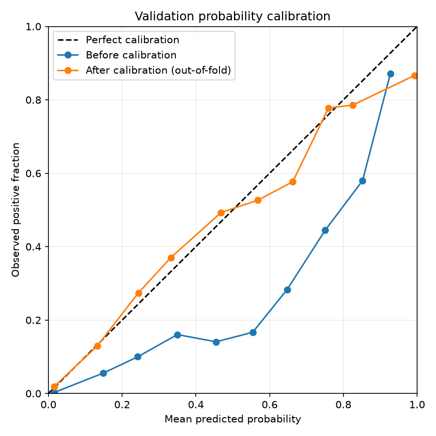

# Calibrating model probabilities with DVC

The `calibrate` stage converts the classifier's soft outputs into probabilities
that better represent the observed frequency of clinically concerning lesions.
It uses only validation images and labels; the test split remains untouched for
the later evaluation stage.

## Choose a method

The method is selected in `params.yaml`:

```yaml
--8<-- "params.yaml:19:24"
```

Supported methods are:

- `isotonic`: learns a flexible monotonic mapping from raw probabilities to
  calibrated probabilities. It makes few shape assumptions but can overfit
  when calibration data are limited.
- `platt`: fits a logistic mapping to the model logits. It is less flexible
  but is often more stable with smaller calibration datasets.

Changing `calibration.method` reruns calibration without retraining the neural
network.

## Cross-validated validation evidence

Fitting and assessing a calibrator on the same samples would make the apparent
improvement optimistic. The stage therefore uses stratified cross-validation
to produce the **after-calibration** validation probabilities: each validation
sample is calibrated by a mapping fitted without that sample.

After producing this out-of-fold evidence, the stage fits one final calibrator
on the complete validation set. That final mapping is stored for application
to the untouched test predictions.

## Run the stage

From the repository root, run calibration and any required upstream stages with:

```bash
uv run --group train dvc repro dvc.yaml:calibrate
```

The stage creates:

```text
results/calibration/probability_calibrator.json
results/calibration/validation_metrics.json
results/calibration/validation_calibration.png
results/calibration/validation_roc.png
results/calibration/validation_confusion_matrix.png
results/calibration/validation_metrics.md
```

`probability_calibrator.json` is a DVC-managed output containing either the
isotonic thresholds or the Platt coefficient and intercept. JSON keeps the
mapping transparent and avoids loading a Python pickle during evaluation.

The original metrics and figures in `results/calibration/` are cached DVC
outputs assigned to `rds-train`. The stage copies the figures and generated metrics table to
`docs/assets/calibration/` for these documentation pages. Review and commit the
copies after reproducing the pipeline. These copies are declared DVC outputs
with `cache: false`, so their contents remain tracked by Git.

## Calibration figure



The reliability diagram compares raw and out-of-fold calibrated probabilities
with perfect calibration. Brier score and expected calibration error in the
table below describe probability quality; lower values are better.

## Validation metrics

--8<-- "docs/assets/calibration/validation_metrics.md"

These are the same metric definitions used for final test evaluation. The
classification metrics use the stated `evaluation.threshold` from `params.yaml`;
changing that threshold reruns calibration reporting without retraining the
classifier. The threshold is applied to each column's probabilities. Calibration
does not select it automatically. At the same numerical threshold, calibration
can change sensitivity and specificity because it changes the probabilities.
Better probability calibration does not necessarily improve classification
metrics at that threshold.

The after-calibration column uses out-of-fold predictions, rather than applying
the final calibrator back to its own fitting samples. The final saved calibrator
is fitted on all validation samples for later inference and testing.

Validation data also inform model selection, so these remain development
results. See [validation performance](validation.md) for the final ROC curve
and confusion matrix. No test data are used to produce this evidence.

Precision, negative predictive value, and F1 follow the existing test metric
implementation, which reports zero when a relevant prediction denominator is
zero; interpret such values alongside the confusion matrix and class counts.

DVC checks both the cached originals and the documentation copies. Missing or
modified outputs make the stage out of date; a calibration run regenerates the
review files and their documentation copies.

After calibration, continue to the
[final evaluation on the untouched test set](evaluation.md).
