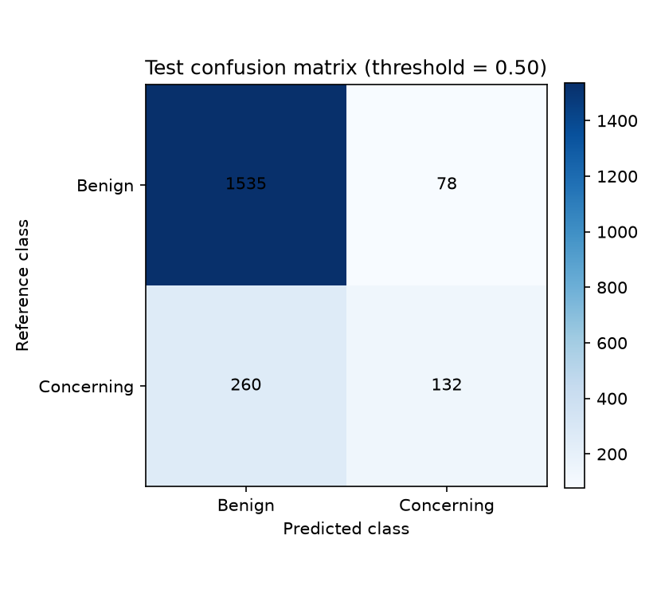
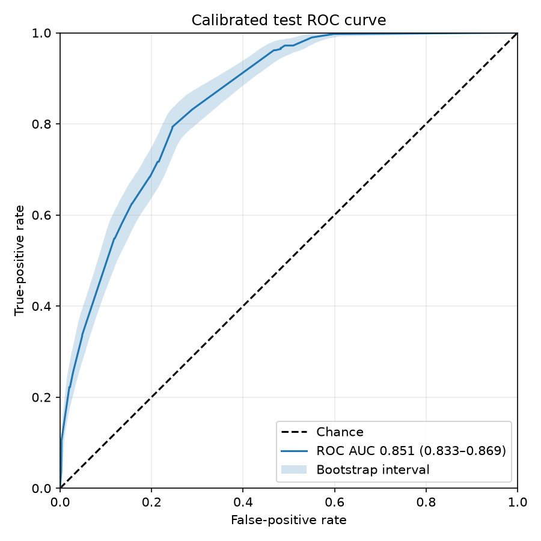
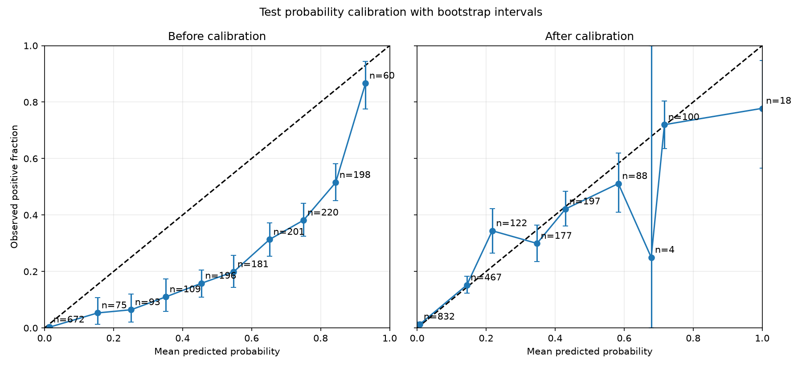

# Evaluating the model on the test set

The `evaluate` stage measures the frozen classifier and validation-fitted
calibrator on the test split. The test data are used only here: this stage does
not fit the model, select a checkpoint, tune the classification threshold, or
alter the calibrator. This separation makes the reported performance a fairer
estimate of how the completed pipeline handles unseen data.

## Evaluation configuration

The fixed threshold, bootstrap settings, and inference settings are versioned
under `evaluation` in `params.yaml`:

```yaml
--8<-- "params.yaml:26:33"
```

The confidence intervals use stratified bootstrap samples, which preserve the
test set's positive and negative class counts. The current threshold of `0.5`
is intentionally explicit. Changing it after examining the test results would
amount to tuning on the test set; threshold selection should instead be added
to the validation workflow.

## Run the stage

From the repository root, run:

```bash
uv run --group train dvc repro evaluate
```

DVC runs any changed upstream stages first, then creates:

```text
results/evaluation/test_predictions.csv
results/evaluation/test_metrics.csv
results/evaluation/confusion_matrix.png
results/evaluation/roc_curve.png
results/evaluation/calibration_curve.png
```

`test_predictions.csv` contains the sample-level labels, raw probabilities,
calibrated probabilities, and final predictions. It is a DVC-managed pipeline
output. The smaller summary CSV and figures are tracked with Git so that the
current result can be reviewed directly in the repository.

## Current performance summary

The following values describe the artifacts generated with the current model,
isotonic calibrator, and `0.5` classification threshold. They are an example
result for this proof-of-concept pipeline, not evidence that the model is ready
for clinical use.

The test set contains 2,005 images: 392 clinically concerning and 1,613 benign
(19.6% prevalence). Overall accuracy is 83.1% (95% bootstrap CI 81.9%–84.4%),
but this figure is influenced by the larger benign class. Balanced accuracy is
64.4% (62.1%–66.9%). The more detailed figures below explain that difference.

### Confusion matrix



The confusion matrix contains 1,535 true negatives, 78 false positives, 132
true positives, and 260 false negatives. At the fixed `0.5` threshold, the
model therefore has high specificity of 95.2% (94.1%–96.2%) but low sensitivity
of 33.7% (29.1%–38.5%). In plain terms, it correctly rejects most benign images
but misses roughly two-thirds of the clinically concerning images. Precision is
62.9% and negative predictive value is 85.5%. This threshold behaviour would be
unsuitable for a screening use case without further validation and threshold
selection.

### ROC curve



The ROC curve summarises discrimination across every possible threshold, not
only `0.5`. Its area under the curve is 0.851 (95% bootstrap CI 0.833–0.869),
showing useful ranking ability despite the weak sensitivity at the chosen
threshold. The shaded band shows pointwise bootstrap uncertainty. Average
precision is 0.545 (0.506–0.589), which should be interpreted alongside the
19.6% positive-class prevalence.

### Calibration curve



The calibration figure compares uncalibrated probabilities with probabilities
from the isotonic mapping fitted on validation data. Points near the diagonal
indicate agreement between predicted probability and observed frequency;
vertical bars are bootstrap intervals, and each `n` label gives the number of
test samples in that bin.

Calibration substantially improves the aggregate test measures: Brier score
falls from 0.176 before calibration to 0.116 after calibration, while expected
calibration error falls from 0.199 to 0.023. Some high-probability bins contain
few samples—for example, one calibrated bin contains only four—so their wide
intervals and visual fluctuations should not be over-interpreted. Calibration
improves the meaning of the probabilities; it does not by itself repair the low
sensitivity at the fixed classification threshold.

## Metrics table

`test_metrics.csv` records ROC AUC, average precision, accuracy, balanced
accuracy, sensitivity, specificity, precision, negative predictive value, F1,
Brier score, and expected calibration error, together with their confidence
limits. It also records sample and confusion-matrix counts, prevalence,
threshold, bootstrap configuration, calibration method, and the raw
pre-calibration measures needed to interpret the reliability diagram.

When the model, data, calibrator, parameters, or evaluation code changes, rerun
the stage and update this written summary from the newly generated artifacts.
