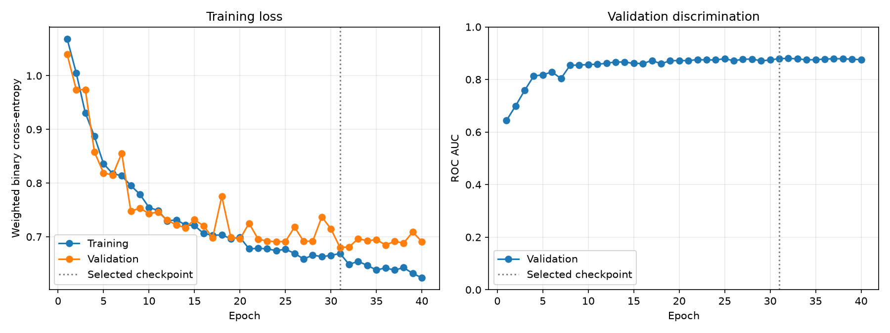

# Training the binary classifier with DVC

The `train` stage fits the proof-of-concept convolutional network using the
processed training images and binary labels. Validation data are used to
select the checkpoint with the lowest validation loss. The test split remains
untouched for a later evaluation stage.

## Training configuration

Training and augmentation settings are versioned in `params.yaml` under
`train`. DVC records these parameters in `dvc.lock`, so
changing a value causes the stage to run again.

Current training parameters are:

```yaml
--8<-- "params.yaml:8:17"
```

The stage uses weighted binary cross-entropy with logits. Its positive-class
weight is calculated from the training labels, helping account for the smaller
number of clinically concerning examples. The validation labels do not
influence this weight.

## MONAI augmentation

MONAI applies random horizontal flips, vertical flips, and 90-degree rotations
to training images as they are loaded. These transformations are suitable for
this orientation-independent proof of concept and do not create duplicate
files. Augmentation is never applied to validation images.

The configured random seed is supplied to NumPy, PyTorch, MONAI, and the
training data loader. `num_workers` remains zero by default to keep this
introductory CPU example straightforward and reproducible.

## Run the stage

From the repository root, run:

```bash
uv run --group train dvc repro dvc.yaml:train
```

DVC runs preprocessing first if its inputs or code have changed. Training
then creates:

```text
results/trained_models/binary_classifier.pt
results/train/history.csv
results/train/loss_curve.png
```

The checkpoint contains the best model state, input-channel count, best epoch,
best validation loss, and training parameters. `history.csv` contains the mean
training and validation loss, plus validation ROC AUC, for every epoch. The PNG is generated from that
CSV by `dermapred.plotting.train`, keeping numerical results separate from
their presentation.

`binary_classifier.pt`, `history.csv`, and `loss_curve.png` are cached DVC
pipeline outputs assigned to `rds-train`.
Do not add them with `dvc add` or commit them directly to Git.
The documentation copy, `docs/assets/validation/training_progress.png`, is
tracked by Git and is not a declared DVC output. DVC therefore does not detect
if this copy is missing. To recreate a missing copy from the cached original:

```bash
cp results/train/loss_curve.png docs/assets/validation/training_progress.png
```

Also, commit `dvc.yaml`, `dvc.lock`,
and the generated `.gitignore` files,
then use `uv run --group train dvc push dvc.yaml` to upload the artifacts.

## Training progress



The left panel shows training and validation loss. The right panel shows
validation ROC AUC measured at the end of each epoch with augmentation disabled.
Training ROC AUC is not calculated. The vertical line marks the checkpoint
selected by the lowest validation loss; the AUC curve does not change that
selection rule.

The training stage copies this figure into `docs/assets/validation/` on each
run. Review and commit the documentation copy alongside the source changes.

After training, continue to
[calibrating the validation probabilities](calibration.md) and reviewing
[validation performance](validation.md).
