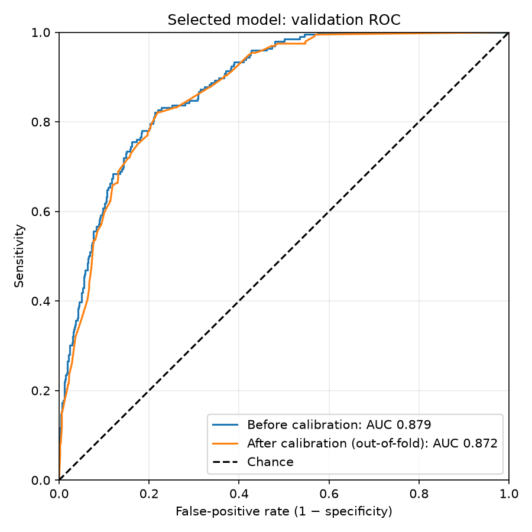
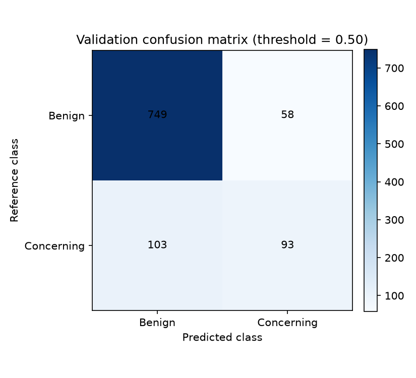

# Validation performance

Validation data support model selection and calibration. They provide a view
of current development performance; they are not an independent final test.
The held-out test dataset is not used for these results.

## Selected model

The training stage selects the checkpoint with the lowest validation loss.
See the [training progress figure](train.md#training-progress) for loss and
validation ROC AUC across epochs. The final ROC curve below uses that selected
checkpoint, rather than the final training epoch.

## Final validation ROC curve



The ROC curve shows sensitivity against the false-positive rate (1 minus
specificity) as the threshold varies. The legend reports ROC AUC before
calibration and after out-of-fold calibration. Calibration is intended to
improve probability estimates; it does not necessarily increase ROC AUC.

After-calibration predictions come from stratified calibration folds: each
sample is calibrated by a mapping fitted without that sample. Different fold
mappings can change rankings across samples. These folds assess calibration;
they do not remove the effect of having used validation data for model selection.

## Classification at the chosen threshold



Sensitivity and specificity describe one operating point and therefore require
a stated probability threshold. The calibration stage uses
`evaluation.threshold` in `params.yaml` (currently `0.5`), with a sample classified
as positive when its calibrated probability is greater than or equal to the
threshold. Calibration itself does not choose a threshold.

The [calibration page](calibration.md#validation-metrics) reports sensitivity,
specificity, and the other metrics used for final testing, together with the
threshold and class counts. Fix any threshold selected during development
before accessing the test results.

## Regenerate the evidence

From the repository root:

```bash
uv run --group train dvc repro
```

This runs the root training and calibration pipeline as needed and refreshes
the figures and metrics used by these pages. Review and commit the documentation
artifacts. Final test evaluation remains a separate, explicit step in
`pipelines/test/dvc.yaml`.
