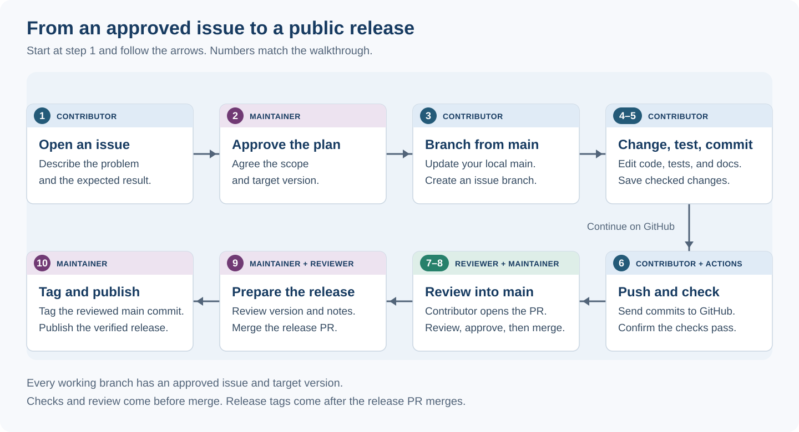
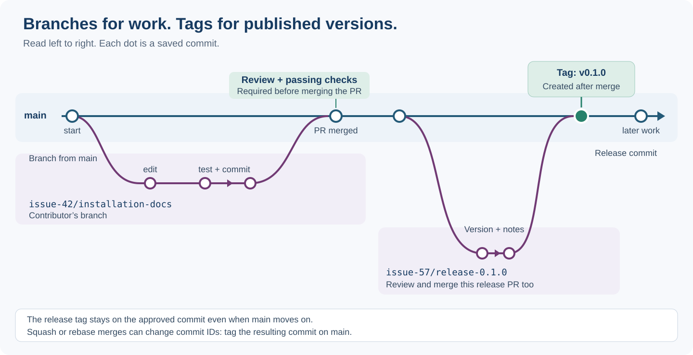

# Development, review, and release: a walkthrough



This guide follows one change from its first idea to a public release. The
example is issue **#42**, “Improve model download error messages”, targeting
version **0.1.0**. Replace these example names and numbers with your own.

You work on a separate branch, test your changes, and ask someone to review
before they become part of `main`. A release happens later, when a maintainer
labels an approved version and publishes it.

## Who does what?

| Role | Responsibility |
| --- | --- |
| Contributor | Proposes a change, writes code and documentation, runs tests, and asks for review. |
| Maintainer | Approves the work and target version, manages the repository, merges approved changes, and publishes releases. |
| Reviewer | Checks that the change works and meets the agreed requirements. Usually another contributor or maintainer. |
| GitHub Actions | Runs the checks configured by the maintainer. It reports results; it does not replace review. |

In a small project, one person may be both contributor and maintainer. Seek
another person's review where possible, especially for a release or model change.

## A few terms before you start

**Git** records changes on your computer. **GitHub** hosts a shared copy online.
Your copy is called *local*; the GitHub copy is the *remote*, normally named
`origin` in Git commands.

| Term | Meaning |
| --- | --- |
| Issue | A GitHub discussion describing a problem or planned piece of work. |
| Branch | A named line of work. Your issue branch lets you make changes without changing `main`. |
| Commit | A saved set of changes with a message explaining them. |
| Push | Send your local commits to GitHub. |
| Pull request (PR) | Ask for your branch's changes to be reviewed and added to another branch. |
| Merge | Add the approved changes to the shared branch. |
| Tag | A fixed name, such as `v0.1.0`, attached to a particular commit. |
| Release | A published version identified by a tag, with release notes and any model files. |

`main` is the shared branch from which new work starts. This project uses
short-lived issue branches; a permanent `dev` branch is not needed. Several
issues can target the same release, and merging a PR does not automatically
publish a release.

## Before the walkthrough

**Responsible: contributor, with help from a maintainer if needed.**

Install Git and uv, create a GitHub account, and set up authentication using
[Using Git and GitHub](github.md) and [Managing Python with uv](uv.md).
The examples below use a terminal for Git and your browser for GitHub.

If you do not already have a local copy:

```bash
git clone https://github.com/ICR-Computational-Imaging/RC4R.git
cd RC4R
```

If you already have a copy, open a terminal in its `RC4R` folder instead.
Run the commands below from that folder. Do not type the explanatory output
shown in separate text blocks.

**Expected result:** you have the repository on your computer and can view it
on GitHub. The main example assumes you have permission to push a branch to
this repository. If you do not, ask the maintainer about contributing through
a [fork](https://docs.github.com/en/get-started/quickstart/fork-a-repo), your own
GitHub copy of the project.

!!! note "GitHub checks need to be configured"
    This repository currently includes a documentation publishing workflow.
    Branch and PR test workflows, model verification, issue/version checks,
    and package publication still need to be added. Repository protection
    settings also need to be confirmed by a maintainer. This walkthrough
    describes the intended process. No checks appearing on GitHub does not
    mean that the tests have passed.

## 1. Describe the work in an issue

**Responsible: contributor. Location: GitHub in your browser.**

Open the repository, choose **Issues → New issue**, and describe the work.
For our example, the issue could contain:

```text
Title: Improve model download error messages

Problem: A failed download does not explain what the user should do next.
Proposed change: Give a clear message when a cached model is missing offline.
Done when: The message explains the problem, a test checks it, and the
          documentation shows the expected behavior.
Proposed target version: 0.1.0
```

Include what will count as a successful result. Create an issue for every
working branch, including documentation and release preparation.

**Expected result:** GitHub gives the issue a number, such as `#42`.
This number connects the discussion, branch, and PR.

## 2. Agree the scope and target version

**Responsible: maintainer. Location: the GitHub issue.**

The maintainer reviews the proposed work and agrees which release should
include it. They leave an explicit comment, for example:

```text
Approved: improve the offline download message and add its test and example.
Target release: 0.1.0.
```

They can assign the issue to a milestone named `v0.1.0`, which groups work
planned for that release. The milestone records the plan; the comment records
approval. See [GitHub's milestone guide](https://docs.github.com/en/issues/using-labels-and-milestones-to-track-work/associating-milestones-with-issues-and-pull-requests).

A version has the form `MAJOR.MINOR.PATCH`, such as `1.2.3`. Compatible fixes
usually change PATCH, new compatible features change MINOR, and incompatible
changes change MAJOR. The maintainer should state the project's expectations
for early `0.x` releases. See [Semantic versioning](semantic_versioning.md).

**Expected result:** you know what to do, how it will be checked, and the
approved target version. Several issues may share that target. You do not
need to change version files on each issue branch. If the plan changes, agree
the new scope and target with the maintainer before merging.

## 3. Start your branch from main

**Responsible: contributor. Location: your local terminal.**

First check for unfinished local changes:

```bash
git status
```

A clean working copy shows `nothing to commit, working tree clean`. If files
are listed as changed, finish or save that work before switching branches.

Update `main`, then create your issue branch:

```bash
git switch main
git pull --ff-only
git switch -c issue-42/download-errors
```

`switch main` selects your local main branch. `pull --ff-only` brings it up to
date without creating an unexpected merge. `switch -c` creates and selects a
new branch. If the pull is rejected because your local `main` has separate
changes, ask a maintainer to help reconcile them before proceeding.

Confirm where you are:

```bash
git branch --show-current
```

**Expected output:**

```text
issue-42/download-errors
```

Your branch exists locally. It is not on GitHub until you push it.

## How the branches fit together



The issue branch starts at a commit on `main`. You add commits there while
other contributors may continue working. Review joins your work back into
`main`. A later release-preparation branch follows the same pattern. The
release tag goes on its resulting commit on `main`, after the release PR merges.

## 4. Make the change and test it

**Responsible: contributor. Location: your editor and local terminal.**

Edit the relevant files. For our example, these might include
`src/dermapred/inference/download.py`, its tests in
`tests/inference/test_download.py`, and the download guide. Keep the work within
the agreed issue and update the tests and explanation alongside the code.

Install the project's recorded dependencies:

```bash
uv sync --locked --group train
```

This creates or updates the local Python environment. The `train` group is
needed by the Dermapred tests; the default development group includes the
other checking tools.

Run these commands one at a time:

```bash
uv run --locked --group train pytest
uv run --locked ruff check .
uv run --locked mypy
uv run --locked mkdocs build --strict
```

| Command | Expected result |
| --- | --- |
| `pytest` | Tests pass; the number of tests depends on the current code. |
| `ruff check` | Reports no formatting or code-quality errors covered by its rules. |
| `mypy` | Reports no type-checking errors. |
| `mkdocs build --strict` | Builds the documentation without warnings treated as errors. |

**Expected result:** the relevant checks succeed. If a check fails, read its
message and fix the problem before continuing. Ask for help if needed;
report an existing environment or repository problem rather than hiding it.

## 5. Save your work in a commit

**Responsible: contributor. Location: your local terminal.**

Review what changed:

```bash
git status
git diff
```

Select the files you intend to include. For example, if you edited the
following two files:

```bash
git add src/dermapred/inference/download.py tests/inference/test_download.py
git diff --staged
git commit -m "Explain missing model files in offline mode"
```

Add any documentation files you changed too. `git add` selects changes for
the next commit; `git diff --staged` shows that selection. `git commit` saves
it locally. It does not send anything to GitHub.

**Expected result:** Git prints a commit identifier and your message.
`git status` shows no remaining changes if you included all intended work.
You can make several focused commits while working on the issue.

## 6. Push the branch and check the GitHub results

**Responsible: contributor; GitHub Actions runs the configured checks.**

Send your branch to GitHub for the first time:

```bash
git push -u origin issue-42/download-errors
```

`-u` remembers which GitHub branch belongs to your local branch. For subsequent
commits on this branch, use:

```bash
git push
```

In your browser, open the repository's **Actions** tab. Find the run for your
branch and latest commit, then read its result. Once branch testing is
configured, the expected result is a successful run. For a failed run, open
the logs, fix the problem locally, test, commit, and push again.

**Expected result:** GitHub contains your branch and commits, and its configured
checks have passed. `main` has not changed. If no test run appears, ask the
maintainer to confirm the workflow configuration before treating this as passed.

## 7. Open a pull request to main

**Responsible: contributor. Location: GitHub in your browser.**

Choose **Pull requests → New pull request**. Set **base** to `main` and
**compare** to `issue-42/download-errors`. Base is the destination;
compare is the branch whose changes you are proposing.

Review the displayed changes, then create the PR. A useful description is:

```text
Closes #42
Target release: 0.1.0, approved in issue #42.

Change: Explain how to obtain missing model files before using offline mode.
Checks: Local tests and checks passed. Latest branch checks passed on GitHub.
Model files: Unchanged.
```

Only claim checks that actually passed. `Closes #42` links the issue and closes
it when the PR merges into the default branch. Use `Refs #42` if the PR completes
only part of the issue. See [linking issues and PRs](https://docs.github.com/en/issues/tracking-your-work-with-issues/using-issues/linking-a-pull-request-to-an-issue).

**Expected result:** the PR shows your changes, issue, target version, and checks.
Opening it asks for review; it does not merge your work.

## 8. Review, update, and merge

**Responsible: reviewer checks the work; contributor makes corrections;
maintainer merges. Location: GitHub and, for corrections, your local branch.**

The reviewer reads the changes and checks them against the issue's agreed
result. They approve the PR or request changes. Make corrections on the same
branch, rerun the relevant checks, then commit and push. The PR updates
automatically; you do not open another one.

If GitHub says the branch needs updating with `main`, start from a clean
working copy on your issue branch:

```bash
git fetch origin
git merge origin/main
```

If conflicts appear, ask for help if you are unsure which changes to keep.
Resolve them, commit the resolution, rerun checks, and push. Changes to the
candidate need fresh checks and review.

When the PR is approved and its required checks pass, the maintainer uses the
repository's permitted merge option on GitHub. They can then delete the branch
on GitHub using the PR's **Delete branch** button.

**Expected result:** the approved changes are on `main`, and the PR is marked
**Merged**. Update your local copy:

```bash
git switch main
git pull --ff-only
```

Start the next piece of work from this updated `main`, with a new approved issue
and branch. Merging does not publish a PyPI package or release model weights.

## 9. Prepare a release when the agreed work is ready

**Responsible: maintainer, with review from another project member.**

Several merged issues can make up one release. When they are ready, create an
approved release issue, then a release-preparation branch from updated `main`:

```bash
git switch main
git pull --ff-only
git switch -c issue-57/release-0.1.0
```

Update the version, release notes, and any model manifest on this branch.
Use bumpversion to keep the configured version files consistent. For an
explicit approved target, install the version tool once if needed, then
preview and apply the change:

```bash
uv tool install bump2version==1.0.1
bumpversion --dry-run --verbose --new-version 0.1.0 build
bumpversion --new-version 0.1.0 build
```

The first command previews the change; the second makes it. Start with a clean
working copy. The current configuration creates a version-change commit and
updates `VERSION`, `.bumpversion.cfg`, and the documentation version.
It does not create a tag. See the [versioning guide](semantic_versioning.md)
for the configuration and other version commands.

If the current version is already `0.1.0.devN`, `bumpversion release` is another
way to reach `0.1.0`. It only removes the development suffix: it would turn
`0.0.1.dev3` into `0.0.1`, not `0.1.0`. Development build numbers are allocated
by the maintainer when preview builds are needed, not independently on every
issue branch.

Run the checks, push this release branch, and open a PR to `main` as in steps
6–8. Review covers the version, notes, and selected model files as well as code.

**Expected result:** a reviewed release-preparation PR has merged into `main`.
The version files identify the intended release. No release tag exists yet.

## 10. Tag the reviewed commit, then publish

**Responsible: maintainer. Location: local terminal, then GitHub and PyPI.**

Copy the resulting commit identifier from the merged release PR on GitHub.
A squash or rebase merge can produce a different commit from the branch's
original commit. Tag the resulting commit on `main`, not the original PR branch.

Update your local copy and check the recent history:

```bash
git switch main
git pull --ff-only
git log --oneline -5
```

Use the actual approved commit identifier in place of `APPROVED_COMMIT_SHA`:

```bash
git tag -a v0.1.0 APPROVED_COMMIT_SHA -m "Release 0.1.0"
git show --no-patch v0.1.0
git push origin v0.1.0
```

The tag is a fixed label for that exact version. Supplying the commit identifier
avoids tagging newer work that may have entered `main` since the release PR.

**Expected result:** GitHub lists `v0.1.0` under **Tags**, pointing to the approved
commit. A pushed tag is not automatically a published GitHub Release unless
release automation has been configured.

For a release with model files, use the upload script to create a draft and
attach the verified files. Install [GitHub CLI](https://cli.github.com/) and
sign in once with `gh auth login`, then run:

```bash
uv run --locked python -m scripts.upload_model_release \
  --repo ICR-Computational-Imaging/RC4R \
  --manifest model-release.json \
  --artifact weights=results/trained_models/binary_classifier.pt \
  --artifact calibrator=results/calibration/probability_calibrator.json
```

**This command uploads the model files to GitHub.** The tag is taken from the
reviewed manifest. The script checks local hashes, prepares the draft, uploads
the attachments using `gh`, and downloads them again to check their contents.
Use `--dry-run` to perform only the local checks before uploading.

**Expected result:** the script prints a link to a draft release. On GitHub,
open **Releases**, review its notes and files, and click **Publish release**
when approved. The script leaves this publication decision to the maintainer.
It does not push a tag or publish to PyPI. See the [model release guide](../dermapred/model_download.md)
for retries, release notes, and the individual steps.

Build the Python package from that same tag in a separate folder:

```bash
git worktree add --detach ../RC4R-release-0.1.0 v0.1.0
cd ../RC4R-release-0.1.0
uv build
```

This creates a separate checkout of the tagged code. `uv build` writes a wheel
(the installable package) and a source archive into its `dist/` folder. This
folder must not already contain packages from older builds.

For this example version, check the wheel in an isolated environment:

```bash
uv run --isolated --no-project \
  --with dist/dermapred-0.1.0-py3-none-any.whl \
  python -c "from dermapred.inference.download import download_model; print('Package imports successfully')"
```

Use the actual wheel filename printed by `uv build`. This checks the installed
package rather than relying on your development environment. It should print
`Package imports successfully`. Also check that its included manifest selects
the correct model, public downloads work, and inference produces the expected
results. Once those checks pass, the maintainer can publish the distributions
using their authorised PyPI account:

```bash
uv publish
```

This command publishes the files in `dist/`; run it only for the approved
release. PyPI authentication must already be configured. See [uv's publishing
guide](https://docs.astral.sh/uv/guides/publish/) for account setup and details.

**Expected result:** the GitHub Release and PyPI package identify the same
software version. The public weights are the exact files that passed review.

## Extra steps when the change includes a model

**Responsible: contributor prepares the files; reviewer verifies them;
maintainer approves public distribution and publishes them.**

A model manifest is a small file listing where to download the model files,
their sizes, and their SHA-256 hashes. A hash is a fingerprint of a file's
contents. The manifest belongs in the PR; the weights stay in private DVC
storage until their public distribution is approved.

Freeze the selected weights and matching calibrator: keep those exact files
for testing and release. In the authorised environment, generate their manifest:

```bash
uv run --locked python -m scripts.create_model_manifest \
  --name dermapred-lenet \
  --base-url 'https://github.com/ICR-Computational-Imaging/RC4R/releases/download/v{version}' \
  --artifact weights=results/trained_models/binary_classifier.pt \
  --artifact calibrator=results/calibration/probability_calibrator.json \
  --output model-release.json
```

**Expected result:** `model-release.json` describes the selected files. This
command reads the version from the project's `VERSION` file, maintained by
bumpversion. With `VERSION` set to `0.1.0`, it also uses `v0.1.0` in the URLs.
Generate the final manifest after the version change in step 9. If you generated
a preview manifest earlier, create a fresh file and review it before replacing
the old manifest; existing files are not overwritten automatically.
This command does not upload files. The public URLs may not exist until release day.
Arrange for the reviewed manifest to be included in the package before releasing;
the template does not yet include a default model manifest in its wheel.

Before the PR can merge, verify both file identity and model behavior:

| Who | What to check |
| --- | --- |
| Contributor | Record the training-code commit, DVC hashes, preprocessing, class meanings, licence, and evaluation results. |
| Reviewer | Confirm that the files match the manifest and that the selected weights and calibrator work with the proposed inference code. |
| Maintainer | Confirm the agreed checks passed and these specific files may be distributed publicly. |

Private model checks run inside the authorised environment, through an
approved runner or a reviewed report identifying the tested code and file
hashes. Passing ordinary unit tests does not prove a model is accurate.
Changed weights, calibration, or inference code need fresh verification.

At release, upload the same verified bytes, without retraining or refitting
calibration. Test actual public downloads before publishing the Python package:

```bash
python -m dermapred.inference.download --manifest model-release.json
python -m dermapred.inference.download --manifest model-release.json --offline
```

Run these with the installed release package and its reviewed manifest. The
first command prints the verified local file paths; the second reuses them
without network access. Also test inference using those files.

If a model is unchanged, a new software release can reuse it by keeping its
compatible model version in the manifest. A public GitHub prerelease can be
used for early download testing only when public distribution is already
permitted; its prerelease label does not restrict access.

See [Releasing and downloading model weights](../dermapred/model_download.md)
for the full model distribution approach.

## Maintainer setup: make the rules enforceable

**Responsible: maintainer. Location: repository settings and workflow files.**

Configure `main` to require PRs, passing checks, and approval before merging.
Require current checks and fresh approval after changes; keep PRs up to date
with `main` or use a merge queue. Restrict bypasses and direct pushes. See
[GitHub's branch protection guide](https://docs.github.com/en/repositories/configuring-branches-and-merges-in-your-repository/managing-protected-branches/about-protected-branches).

Add GitHub Actions workflows for branch and PR checks, and a model-verification
check where applicable. Add a check for the issue and approved version target
if these requirements should be enforced automatically. Keep institutional
credentials out of untrusted PR jobs.

An issue number in a branch name, a milestone, or this written guide does not
configure those checks. Confirm they exist and are required before relying on
GitHub to prevent an unverified merge.
