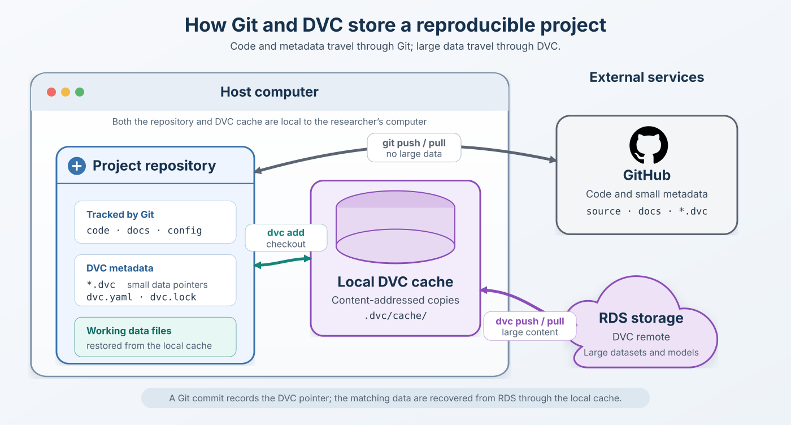

# Managing data with DVC

## Introduction

[Data Version Control (DVC)](https://dvc.org/) records which datasets, models,
and other large artefacts belong with each version of the code. It complements
Git rather than replacing it:

- Git stores the code, documentation, configuration, and small DVC metadata
  files.
- DVC stores large files in a local cache and, when configured, copies them to
  separate remote storage.
- GitHub stores the Git repository, but not the DVC-managed data itself.

A `.dvc` metadata file acts like a pointer. It records a content
[hash](https://kc7cyber.com/blog/what-is-a-file-hash) and other
information needed to restore the corresponding data. When that pointer is
committed to Git, checking out an earlier Git revision and running `dvc pull`
recovers the matching version of the data from the DVC *remote*.

This separation is useful for reproducible research because code and data
versions remain associated without placing large or sensitive files in Git.
However, DVC is not an access-control or anonymisation system. Only place data
in a remote whose security, permissions, retention, and location have been
approved for that dataset.

## Overview of DVC workflow



## Install DVC for this project

Core DVC is declared in the `train` dependency group in `pyproject.toml`.
Install the training environment from the repository root:

```bash
uv sync --group train
uv run dvc version
```

Use `uv run dvc ...` for the commands in this guide so that the repository's
managed DVC installation is used.

## Initialise DVC

*If you start a brand new, empty project*, initialise DVC once, from the root of the Git
repository:

```bash
uv run dvc init
git status
```

This creates `.dvc/` configuration files and updates `.gitignore`. Commit these
small files to Git so every clone knows that the repository uses DVC:

```bash
git add .dvc .gitignore
git commit -m "Initialise DVC"
```

Do not run `dvc init` again after cloning an already initialised repository.

## A simple DVC workflow

### 1. Add the data

Place project data in `data/raw_data/`, then ask DVC to track the files:

```bash
uv run dvc add data/raw_data/*
```

DVC places the file contents in its *local cache*, creates a small `.dvc` pointer
for each dataset, and adds the original data to `.gitignore` so they are note tracked by Git.
Check the result:

```bash
git status
uv run dvc status
```

Commit the DVC metadata and `.gitignore`, but not the original data files:

```bash
git add data/raw_data/*.dvc data/.gitignore
git commit -m "Track dataset with DVC"
```

### 2. Copy the data to remote storage

After configuring one of the remotes below, upload the cached data:

```bash
uv run dvc push
```

`dvc push` transfers DVC-managed content. It does not push Git commits, so also
publish the metadata normally:

```bash
git push
```

The DVC upload should normally happen before the Git push. This avoids
publishing pointers that collaborators cannot yet retrieve.

### 3. Retrieve the project elsewhere

An authorised collaborator can clone the Git repository and install the
training environment:

```bash
git clone <repository-url>
cd <repository-directory>
uv sync --group train
uv run dvc remote list
```

Before pulling data, the collaborator must be able to access a configured DVC
remote:

- If `.dvc/config` contains a shared RDS path, mount the RDS SMB share at that
  path first.
- If the RDS mount path differs between computers, configure it for this clone:

```bash
uv run dvc remote add --local --default RDS <mounted-rds-path>
```

- If no remote is listed, obtain the approved remote location from the project
  owner and configure it using one of the sections below.

After the remote is configured and accessible, retrieve the data:

```bash
uv run dvc pull
```

`git pull` retrieves code and DVC pointers; `dvc pull` retrieves the large files
referenced by those pointers. Access to the Git repository does not
automatically grant access to its DVC storage.

### 4. Record a changed dataset

After deliberately replacing or regenerating one or more datasets, refresh their
metadata, review it, and upload the new content:

```bash
uv run dvc add data/raw_data/*
git diff
uv run dvc push
git add data/raw_data/*.dvc
git commit -m "Update dataset"
git push
```

Do not change the training, validation, or test split casually. Record why the
dataset changed, where it came from, and which processing code produced it.

### 5. Restore an earlier version

Git determines which DVC pointers are current. After checking out a branch,
tag, or commit, restore its corresponding data from the configured remote with:

```bash
git switch <branch-name>
uv run dvc pull
```

`dvc pull` downloads any missing objects into the local DVC cache and then
checks them out into the workspace. Objects already present in the cache do not
need to be downloaded again.

If the required version is known to be complete in the local cache, use
`dvc checkout` to restore the workspace without contacting the remote:

```bash
uv run dvc checkout
```

This is faster and works offline, but it fails when a required object is absent
from the cache. An interrupted `dvc pull` can be run again; DVC can reuse
objects that were successfully cached and retrieve those that are still
missing.

## Configure the RDS SMB remote

DVC does not connect to SMB using an `smb://` URL. First mount the SMB share
using the operating system, then configure its mounted directory as a DVC
filesystem remote. Confirm that the share is approved for the data and that the
current user has the required read or write permissions.

Example mount locations might be:

| Operating system | Example mounted DVC storage directory |
| --- | --- |
| macOS | `/Volumes/RDS/RC4R-dvc` |
| Linux | `/mnt/RDS/RC4R-dvc` |
| Windows | `R:\RC4R-dvc` |

The directory should be dedicated to DVC storage. Do not manually reorganise
its hashed files or use it as the project's working `data/` directory.

If every contributor uses the same mount path, add a shared remote named
`RDS`:

```bash
uv run dvc remote add --default RDS /Volumes/RDS/RC4R-dvc
git add .dvc/config
git commit -m "Configure RDS DVC remote"
```

Replace the example path with the real mounted path. The remote's name is
case-sensitive.

When mount paths differ between computers or operating systems, keep the path
local to each clone instead:

```bash
uv run dvc remote add --local --default RDS /Volumes/RDS/RC4R-dvc
```

This writes the setting to the Git-ignored `.dvc/config.local`. Each
contributor repeats the command with the correct path for their computer. Test
that the share is mounted and accessible before transferring data:

```bash
uv run dvc remote list
uv run dvc status --remote RDS
```

If the network share is unavailable, stop and mount it rather than allowing the
operating system to create an ordinary local directory at the expected mount
path. Otherwise, data may be written to the computer instead of RDS.

The DVC documentation describes mounted network storage under
[filesystem remotes](https://dvc.org/doc/user-guide/data-management/remote-storage#file-systems-local-remotes).

## Configure a Google Drive remote

***We do not endorse*** the use of Google Drive for storing your data due to
institutional restrictions on using cloud-based, third-party data storage.
It is important to keep your data secure, especially in the context of healthcare
research. However, we include this for completeness on any other projects you
wish to develop and to demonstrate how DVC can be used to also manage such systems.

Google Drive is convenient for small teams, but its API has quotas and DVC's
default Google application can encounter provider restrictions. For sustained
or automated use, follow DVC's guidance on using a dedicated Google Cloud
project or service account.

1. Create a folder in Google Drive specifically for this project's DVC data.
2. Share the folder only with authorised contributors.
3. Copy the folder ID from its browser URL. For a URL ending in
   `/folders/1AbCdEf...`, the folder ID is `1AbCdEf...`.
4. Add it as a DVC remote and make it the default:

```bash
uv run dvc remote add --default GDrive gdrive://<folder-id>/RC4R
git add .dvc/config
git commit -m "Configure Google Drive DVC remote"
```

The remote name `GDrive` is an ordinary project label; the `gdrive://` URL
selects the Google Drive backend. On the first `dvc push` or `dvc pull`, DVC
opens a browser so the user can sign into Google and authorise access:

```bash
uv run dvc push
```

Each contributor should authenticate with their own authorised account. Never
commit cached OAuth credentials or service-account key files. User-specific or
sensitive settings must be written to `.dvc/config.local` with `--local`, for
example:

```bash
uv run dvc remote modify --local GDrive profile rc4r
```

The local configuration file is Git-ignored and must be configured separately
in each clone. See DVC's complete
[Google Drive remote guide](https://dvc.org/doc/user-guide/data-management/remote-storage/google-drive)
for shared drives, custom OAuth applications, service accounts, and current
provider limitations.

## Working with more than one remote

DVC can retain both `GDrive` and `RDS` configurations, but only one is the
default. List them with:

```bash
uv run dvc remote list
```

Select a remote explicitly for a transfer:

```bash
uv run dvc push --remote RDS
uv run dvc pull --remote GDrive
```

Change the project default with:

```bash
uv run dvc remote default RDS
```

Avoid copying sensitive data to both remotes merely because both are
available. The approved storage location is determined by information
governance, not convenience.

## Reproducing a workflow with `dvc repro`

`dvc add` versions existing data, whereas a DVC pipeline describes how files
are produced. Use a pipeline when the project repeatedly runs scripts or
commands to transform inputs into outputs.

A pipeline consists of one or more **stages**. Each stage declares:

- `cmd`: the command to execute.
- `deps`: the data, code, and configuration used by the command.
- `outs`: the files or directories produced by the command.
- `params`: optional parameter values that can also trigger reproduction.

DVC connects stages when the output of one stage is a dependency of another.
This forms a directed acyclic graph, or DAG, which determines the execution
order.

### Pipeline files

| File | Purpose | How it is maintained |
| --- | --- | --- |
| `dvc.yaml` | Human-readable stage definitions: commands, dependencies, outputs, parameters, metrics, and plots | Edit deliberately and review in Git |
| `dvc.lock` | Exact commands and content hashes from the last successful reproduction | Generated by DVC; do not edit manually |

Commit both files to Git. Together with the source code, dependency lockfile,
parameters, and DVC remote, they allow another authorised researcher to
identify and reproduce the same workflow.

### A simple general-purpose pipeline

The following example makes no assumption about whether the workflow is for
machine learning, image processing, or another form of analysis:

```yaml title="dvc.yaml"
stages:
  prepare:
    cmd: uv run python src/prepare_data.py
    deps:
      - src/prepare_data.py
      - data/raw_data
    outs:
      - data/processed

  analyse:
    cmd: uv run python src/run_analysis.py
    deps:
      - src/run_analysis.py
      - data/processed
    outs:
      - results/analysis
```

In this example:

1. `prepare` runs first because it creates `data/processed`.
2. `analyse` runs second because it depends on `data/processed`.
3. A change to the raw data or preparation script invalidates both stages.
4. A change only to the analysis script invalidates only `analyse`.

Adapt the paths and commands to the actual project. Each script must create any
required output directories itself; DVC may remove old stage outputs before
rerunning their commands.

The initial input, such as `data/raw_data`, can be tracked with `dvc add`. Do
not also run `dvc add` on `data/processed` or `results/analysis`: outputs listed
in `dvc.yaml` are cached and versioned automatically through `dvc.lock`.

### Creating stages from the command line

Stages can be written directly in `dvc.yaml`, which is usually clearest for
review. Alternatively, DVC can create the example stages:

```bash
uv run dvc stage add --name prepare \
  --deps src/prepare_data.py \
  --deps data/raw_data \
  --outs data/processed \
  "uv run python src/prepare_data.py"

uv run dvc stage add --name analyse \
  --deps src/run_analysis.py \
  --deps data/processed \
  --outs results/analysis \
  "uv run python src/run_analysis.py"
```

These commands define the stages; they do not run the pipeline unless `--run`
is added. Inspect the generated `dvc.yaml` before continuing.

### Previewing and running the pipeline

Display the pipeline graph and check which stages are out of date:

```bash
uv run dvc dag
uv run dvc status
```

Preview the commands DVC would execute without running them:

```bash
uv run dvc repro --dry
```

Run all required stages in dependency order:

```bash
uv run dvc repro
```

DVC compares the commands, dependencies, parameters, and previous output
hashes recorded in `dvc.lock`. Unchanged stages are skipped. When an upstream
stage changes, DVC also reproduces affected downstream stages.

To reproduce a particular stage and any changed stages it depends on, name the
stage:

```bash
uv run dvc repro analyse
```

Force reproduction even when DVC detects no change only when there is a clear
reason, such as checking nondeterministic behaviour:

```bash
uv run dvc repro --force analyse
```

### Recording reproduced results

After successful reproduction, inspect what changed:

```bash
uv run dvc status
git status
git diff -- dvc.yaml dvc.lock
```

Commit the pipeline definition, lockfile, source code, parameters, and relevant
`.gitignore` changes. Pipeline output contents remain outside Git:

```bash
git add dvc.yaml dvc.lock src/ .gitignore
git commit -m "Reproduce data pipeline"
uv run dvc push
git push
```

Add only paths that belong to the change; this command is illustrative.
Uploading with `dvc push` before publishing the Git commit ensures that other
contributors can retrieve the outputs referenced by the new `dvc.lock`.

### What `dvc repro` does not guarantee

`dvc repro` records file dependencies and executes commands consistently, but
reproducibility also depends on the project itself. The workflow should:

- Keep `pyproject.toml` and `uv.lock` under Git control.
- Record relevant configuration and parameters instead of relying on manual
  choices.
- Set and record random seeds where deterministic behaviour is required.
- Avoid undeclared input files, environment variables, and external services.
- Record hardware or platform requirements when they can affect results.
- Make each stage non-interactive and safe to run from a clean workspace.

See [defining DVC pipelines](https://dvc.org/doc/user-guide/pipelines/defining-pipelines)
and the [`dvc repro` reference](https://dvc.org/doc/command-reference/repro) for
more advanced features such as metrics, plots, parameter files, experiments,
and partial reproduction.

## DVC cheat sheet

| Command | Purpose |
| --- | --- |
| `uv run dvc init` | Initialise DVC in the Git repository; run once. |
| `uv run dvc add <path>` | Begin tracking a file or directory, or refresh its pointer after it changes. |
| `uv run dvc status` | Compare the workspace with the current DVC metadata. |
| `uv run dvc diff` | Summarise changed DVC-tracked data between revisions. |
| `uv run dvc remote add -d <name> <url>` | Add and select a default shared remote. |
| `uv run dvc remote add --local -d <name> <path>` | Add a machine-specific default remote without committing its path. |
| `uv run dvc remote list` | List configured remote names and locations. |
| `uv run dvc push` | Upload locally cached data referenced by the repository. |
| `uv run dvc pull` | Download required data from remote storage and place it in the workspace. |
| `uv run dvc fetch` | Download required data into the cache without updating workspace files. |
| `uv run dvc checkout` | Make workspace data match the current Git revision using the local cache. |
| `uv run dvc dag` | Display the dependency graph formed by pipeline stages. |
| `uv run dvc repro --dry` | Preview which pipeline commands would run. |
| `uv run dvc repro` | Reproduce changed pipeline stages in dependency order. |
| `uv run dvc repro <stage>` | Reproduce a target stage and any changed dependencies it requires. |
| `uv run dvc remove <file>.dvc` | Stop tracking an output through its `.dvc` pointer. Review before committing. |
| `uv run dvc doctor` | Display diagnostic information useful when reporting a problem. |

Use `uv run dvc <command> --help` before unfamiliar or destructive operations.
In particular, do not run `dvc gc` against shared storage without understanding
which cached versions it will remove.

## What belongs in Git

Commit these files:

- `.dvc/config`, when it contains non-sensitive shared remote configuration.
- `.dvcignore` and the other files created by `dvc init`.
- Generated `.dvc` pointer files.
- `.gitignore` changes generated by `dvc add`.
- `dvc.yaml` and `dvc.lock` when reproducible pipelines are added later.

Do not commit these files:

- The large data or model files managed by DVC.
- `.dvc/cache/`.
- `.dvc/config.local`.
- OAuth tokens, passwords, service-account keys, or SMB credentials.

## Further reading

- [DVC getting started](https://dvc.org/doc/start)
- [DVC command reference](https://dvc.org/doc/command-reference)
- [Tracking data with `dvc add`](https://dvc.org/doc/command-reference/add)
- [DVC remote storage](https://dvc.org/doc/user-guide/data-management/remote-storage)
- [Google Drive remote configuration](https://dvc.org/doc/user-guide/data-management/remote-storage/google-drive)
- [DVC pipelines](https://dvc.org/doc/user-guide/pipelines)
- [`dvc repro` command reference](https://dvc.org/doc/command-reference/repro)
- [DVC security and privacy](https://dvc.org/doc/user-guide/privacy)
